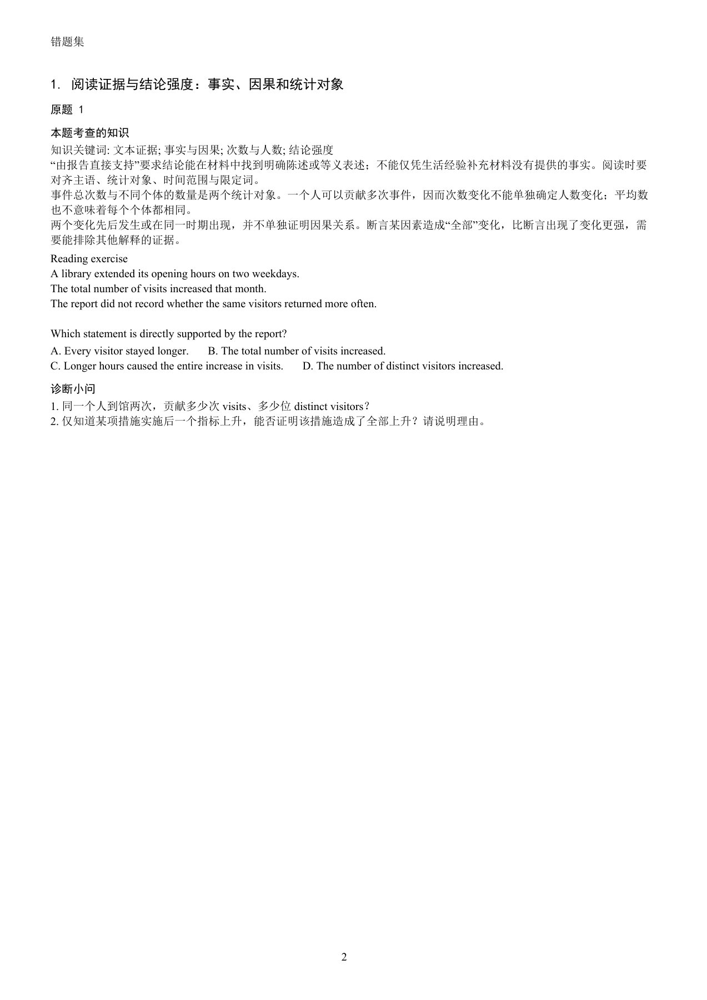

# 通用错题集 · mistake-workbook

把错题照片、扫描件或作答截图，整理成按知识点分类、能独立复习的 PDF 错题集。

这是供 **Codex 等具备视觉和文件工具的 Agent** 使用的 Skill，不限定管综或某一学科。识别与教学由 Agent 完成，随附 Python 工具负责紧凑排版和结构检查。

## 一本错题集里有什么

- **知识解释在题前**：同时给关键词、知识的含义、适用条件和题目要求的思维操作。
- **原题与诊断小问放一起**：诊断参考答案从紧接下一页开始，帮助区分可能的卡点。
- **一类题，多种有效思路**：解释各方法的步骤、依据、适用范围与常见陷阱。
- **逐题完整解析**：核对材料、条件与选项；根据可见作答提出可验证的错因假设。
- **每类三道原创补练**：练不同表征、迁移与边界，答案和解析隔页呈现。
- **紧凑 PDF**：目录链接与书签，默认 A4 黑白排版，多题连续排，不强制一页一道题。

选择、填空、计算、证明、阅读、写作、实验、编程及开放题都可以按题目特点处理；开放题使用参考答案、依据与评价标准。混合学科先分学科，再按具体知识分类。

## 安装与使用

在 Codex 中对 skill-installer 说：

> 从 GitHub 仓库 rebelzz460/test 的 mistake-workbook 目录安装 Skill，名称为 mistake-workbook。

也可下载仓库后，将其中的 `mistake-workbook` 目录复制到个人 skills 目录。默认目录为 `~/.codex/skills`；自定义环境以实际 `CODEX_HOME/skills` 为准。安装后重启 Codex，或在新的会话中启用技能。

随后提交错题图片或图片文件夹，并说：

> 使用 mistake-workbook，把这些图片中的全部错题整理成完整 PDF 错题集。

能从图片判断的学科、题型和范围会直接处理；题面缺失、字迹影响答案或批改标记含义不清时，需要补充相应信息。已知考试或课程会先核对适用的知识框架；公开题库可用于交叉验证，不作为必要前提。

## 虚构阅读样例

仓库中的演示题与作答均为虚构内容，展示 1 类错题、1 道原题、多角度解析与 3 道新题，不包含个人考试资料。

[查看完整样例 PDF](examples/reading/workbook.pdf) · [查看结构化样例](examples/reading/workbook.json)



## 排版工具

Python 3.10+，依赖 ReportLab、Pillow、pypdf。已在 Python 3.12 下运行并检查样例。

```bash
python -m pip install -r requirements.txt
python scripts/build_workbook.py examples/reading/workbook.json --output outputs/错题集.pdf --manifest work/layout.json
python scripts/check_workbook.py examples/reading/workbook.json --pdf outputs/错题集.pdf --manifest work/layout.json --report work/checks.json
```

上面的命令在技能目录（仓库中的 `mistake-workbook`）运行。数据结构见 [workbook-data.md](references/workbook-data.md)，教学要求见 [teaching-quality.md](references/teaching-quality.md)。中文需本机可用、具有所需字形且允许嵌入的字体；仓库不分发字体。复杂公式、图表或文字系统可以使用更合适的原生排版工具，仍保持完整内容与题答分隔。

两个脚本不执行 OCR，也不自动生成学科解析。结构检查通过不能证明题面识别或学科答案正确；工作流要求独立解答、OCR 复核和 PDF 视觉检查。资料处理方式取决于所使用的 Agent 平台与工具。

## 仓库结构

```text
SKILL.md                         Agent 工作流程
agents/openai.yaml               技能入口信息
references/workbook-data.md      内部排版数据格式
references/teaching-quality.md   教学与复核要求
scripts/build_workbook.py         PDF 排版
scripts/check_workbook.py         内容保留与分页结构检查
examples/reading/                虚构阅读演示
```

## 许可证

源代码、技能文档和虚构演示内容使用 [MIT License](LICENSE)。第三方库、字体及用户提供的题目资料遵循其各自许可；本仓库的许可不覆盖这些外部内容。
